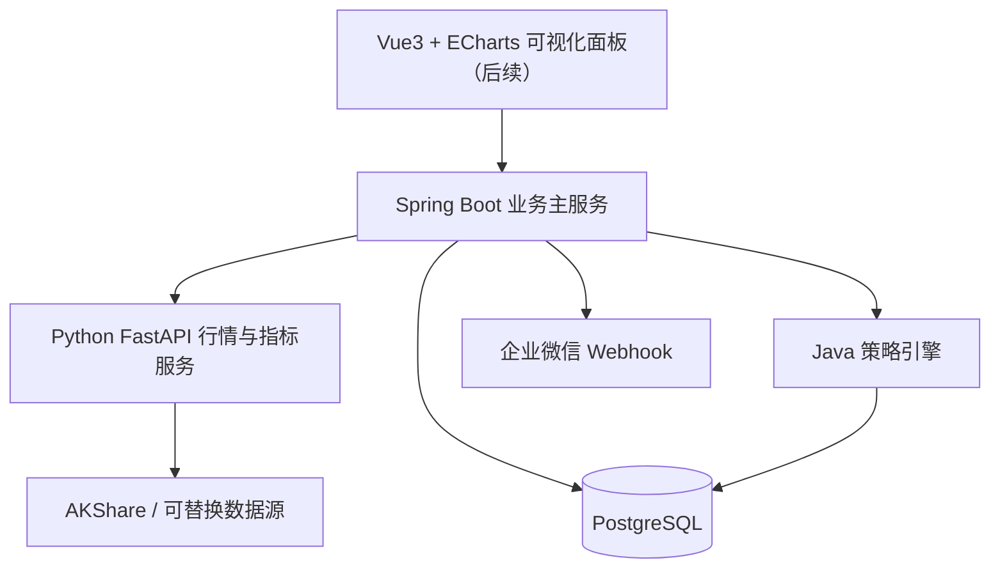
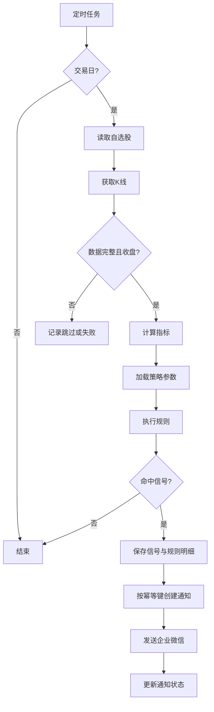

# StockSentinel A股智能监控系统技术方案

> 版本：v1.0  
> 日期：2026-10-20  
> 定位：个人使用的A股量化辅助决策平台  
> 交易风格：5–30个交易日波段交易  
> 范围：全市场选股 + 自选股监控  
> 边界：仅提供分析与提醒，不自动下单；所有交易由用户自行决定。

## 1. 项目目标

StockSentinel 通过行情采集、技术指标计算、策略规则评估、信号持久化和企业微信推送，帮助用户减少人工盯盘。第一阶段先完成自选股日线监控闭环，第二阶段扩展全市场选股，后续增加回测、筹码估算、AI解释与可视化。

### 核心原则

- **量化规则生成信号，AI负责解释，不让大模型直接决定交易。**
- 选股候选与交易信号分开；高分股票不等于立即买入。
- 信号必须可复现、可解释、可追踪、可回测。
- 数据异常时跳过分析，不能把缺失行情当成无信号。
- 不承诺收益，不提供自动下单功能。

## 2. 技术架构



| 模块 | 技术选型 | 职责 |
|---|---|---|
| 主服务 | JDK 21、Spring Boot 3.x、Maven | REST API、调度、规则、信号、通知 |
| 数据访问 | MyBatis-Plus、Flyway | ORM与数据库版本迁移 |
| 计算服务 | Python 3.11+、FastAPI、pandas、NumPy | 行情适配、清洗、MA/MACD/量能计算 |
| 行情 | AKShare（初期） | 股票基础资料、日K线、板块数据；须验证接口稳定性 |
| 存储 | PostgreSQL 18 | 股票、行情、指标、策略、信号、任务、通知 |
| 调度 | Spring Scheduling | 单实例交易日定时任务 |
| 通知 | 企业微信群机器人 Webhook | 信号、风险、复盘提醒 |
| 前端（后续） | Vue 3、ECharts | K线、自选股、策略面板 |
| 测试 | JUnit 5、pytest | 单元测试与集成测试 |
| 部署 | Docker Compose | 本地及轻量服务器部署 |

第一阶段采用**模块化单体 Java + 独立 Python 计算服务**，不引入 Kafka、Kubernetes 等非必要基础设施。Java 统一管理业务数据库写入；Python 仅提供标准化行情和计算结果。Python API 仅内网访问。

## 3. 功能需求与阶段划分

| 功能 | 第一阶段 | 后续 |
|---|---|---|
| 股票基础信息同步 | 必须 | 定期全量更新 |
| 自选股增删改查 | 必须 | 分组、标签 |
| 日K线采集与持久化 | 必须 | 全市场批量采集 |
| MA5/10/20/60、MACD、量能比 | 必须 | RSI、KDJ、ATR |
| 波段趋势策略 | 必须 | 多策略组合 |
| 企业微信通知 | 必须 | 个性化模板、摘要 |
| 交易日定时任务 | 必须 | 盘中分钟级监控 |
| 板块轮动、全市场排名 | 预留接口 | 第二阶段 |
| 筹码分布估算 | 不实现 | 第二/三阶段 |
| 历史回测、交易成本 | 不实现 | 第三阶段 |
| AI信号解释、可视化 | 不实现 | 第四阶段 |
| 自动下单 | 不支持 | 暂不规划 |

### 第一阶段验收标准

1. API可添加、删除、查询自选股（如600487）。
2. 至少拉取并保存120个交易日的日K线。
3. 正确计算MA5/10/20/60、MACD DIF/DEA/柱体、量能比。
4. 收盘后自动更新并评估自选股。
5. 规则命中后保存买入观察、卖出观察或风险预警及命中依据。
6. 企业微信收到股票代码、参考价格、指标依据、风险提示。
7. 同一股票、日期、策略版本、信号类型不重复生成与推送。
8. 数据不足、采集失败、通知失败均记录明确状态。
9. 支持手动任务、任务日志、历史信号查询。
10. 无有效行情时不生成新的交易建议。

## 4. 数据库设计

### 4.1 核心表

| 表 | 说明 |
|---|---|
| `stock_info` | 股票基本信息 |
| `stock_watchlist` | 自选股配置 |
| `market_daily_bar` | 日K线（含复权标识） |
| `market_indicator_daily` | 每日指标与计算版本 |
| `strategy_definition` | 策略与参数 |
| `signal_event` | 信号事件 |
| `signal_rule_hit` | 规则命中明细 |
| `notify_record` | 通知状态、重试、去重 |
| `job_execution` | 调度任务执行记录 |
| `market_calendar` | A股交易日历 |

### 4.2 第一阶段 PostgreSQL DDL

```sql
CREATE TABLE stock_info (
    id BIGINT GENERATED BY DEFAULT AS IDENTITY PRIMARY KEY,
    symbol VARCHAR(12) NOT NULL UNIQUE,
    name VARCHAR(100) NOT NULL,
    exchange VARCHAR(10) NOT NULL,
    industry VARCHAR(100),
    listing_date DATE,
    status VARCHAR(20) NOT NULL DEFAULT 'ACTIVE',
    updated_at TIMESTAMPTZ NOT NULL DEFAULT now()
);

CREATE TABLE stock_watchlist (
    id BIGINT GENERATED BY DEFAULT AS IDENTITY PRIMARY KEY,
    symbol VARCHAR(12) NOT NULL REFERENCES stock_info(symbol),
    enabled BOOLEAN NOT NULL DEFAULT TRUE,
    remark VARCHAR(500),
    created_at TIMESTAMPTZ NOT NULL DEFAULT now(),
    UNIQUE(symbol)
);

CREATE TABLE market_daily_bar (
    id BIGINT GENERATED BY DEFAULT AS IDENTITY PRIMARY KEY,
    symbol VARCHAR(12) NOT NULL REFERENCES stock_info(symbol),
    trade_date DATE NOT NULL,
    open_price NUMERIC(18,4) NOT NULL,
    high_price NUMERIC(18,4) NOT NULL,
    low_price NUMERIC(18,4) NOT NULL,
    close_price NUMERIC(18,4) NOT NULL,
    volume NUMERIC(24,4) NOT NULL,
    amount NUMERIC(24,4),
    turnover_rate NUMERIC(12,6),
    adjustment VARCHAR(10) NOT NULL DEFAULT 'NONE',
    source VARCHAR(40) NOT NULL,
    fetched_at TIMESTAMPTZ NOT NULL DEFAULT now(),
    UNIQUE(symbol, trade_date, adjustment)
);
CREATE INDEX idx_daily_bar_symbol_date ON market_daily_bar(symbol, trade_date DESC);

CREATE TABLE market_indicator_daily (
    id BIGINT GENERATED BY DEFAULT AS IDENTITY PRIMARY KEY,
    symbol VARCHAR(12) NOT NULL REFERENCES stock_info(symbol),
    trade_date DATE NOT NULL,
    ma5 NUMERIC(18,6),
    ma10 NUMERIC(18,6),
    ma20 NUMERIC(18,6),
    ma60 NUMERIC(18,6),
    dif NUMERIC(18,8),
    dea NUMERIC(18,8),
    macd_hist NUMERIC(18,8),
    volume_ratio NUMERIC(18,6),
    calculation_version VARCHAR(30) NOT NULL,
    adjustment VARCHAR(10) NOT NULL DEFAULT 'NONE',
    calculated_at TIMESTAMPTZ NOT NULL DEFAULT now(),
    UNIQUE(symbol, trade_date, calculation_version, adjustment)
);

CREATE TABLE strategy_definition (
    id BIGINT GENERATED BY DEFAULT AS IDENTITY PRIMARY KEY,
    code VARCHAR(60) NOT NULL UNIQUE,
    name VARCHAR(100) NOT NULL,
    version VARCHAR(30) NOT NULL,
    parameters JSONB NOT NULL DEFAULT '{}'::jsonb,
    enabled BOOLEAN NOT NULL DEFAULT TRUE,
    created_at TIMESTAMPTZ NOT NULL DEFAULT now()
);

CREATE TABLE signal_event (
    id BIGINT GENERATED BY DEFAULT AS IDENTITY PRIMARY KEY,
    symbol VARCHAR(12) NOT NULL REFERENCES stock_info(symbol),
    trade_date DATE NOT NULL,
    strategy_code VARCHAR(60) NOT NULL,
    strategy_version VARCHAR(30) NOT NULL,
    signal_type VARCHAR(30) NOT NULL,
    score NUMERIC(6,2),
    reference_price NUMERIC(18,4),
    reason TEXT NOT NULL,
    risk_note TEXT,
    details JSONB NOT NULL DEFAULT '{}'::jsonb,
    created_at TIMESTAMPTZ NOT NULL DEFAULT now(),
    UNIQUE(symbol, trade_date, strategy_code, strategy_version, signal_type)
);
CREATE INDEX idx_signal_event_date ON signal_event(trade_date DESC, symbol);

CREATE TABLE signal_rule_hit (
    id BIGINT GENERATED BY DEFAULT AS IDENTITY PRIMARY KEY,
    signal_id BIGINT NOT NULL REFERENCES signal_event(id),
    rule_code VARCHAR(80) NOT NULL,
    observed_value VARCHAR(100),
    threshold_value VARCHAR(100),
    passed BOOLEAN NOT NULL,
    explanation TEXT
);

CREATE TABLE notify_record (
    id BIGINT GENERATED BY DEFAULT AS IDENTITY PRIMARY KEY,
    signal_id BIGINT REFERENCES signal_event(id),
    channel VARCHAR(30) NOT NULL DEFAULT 'WECOM',
    message_type VARCHAR(40) NOT NULL,
    idempotency_key VARCHAR(160) NOT NULL UNIQUE,
    status VARCHAR(20) NOT NULL DEFAULT 'PENDING',
    attempts INT NOT NULL DEFAULT 0,
    next_retry_at TIMESTAMPTZ,
    last_error TEXT,
    sent_at TIMESTAMPTZ,
    created_at TIMESTAMPTZ NOT NULL DEFAULT now()
);

CREATE TABLE job_execution (
    id BIGINT GENERATED BY DEFAULT AS IDENTITY PRIMARY KEY,
    job_name VARCHAR(80) NOT NULL,
    status VARCHAR(20) NOT NULL,
    started_at TIMESTAMPTZ NOT NULL DEFAULT now(),
    finished_at TIMESTAMPTZ,
    processed_count INT NOT NULL DEFAULT 0,
    success_count INT NOT NULL DEFAULT 0,
    failed_count INT NOT NULL DEFAULT 0,
    error_message TEXT
);
CREATE INDEX idx_job_execution_name_time ON job_execution(job_name, started_at DESC);

CREATE TABLE market_calendar (
    trade_date DATE PRIMARY KEY,
    exchange VARCHAR(10) NOT NULL DEFAULT 'CN',
    is_open BOOLEAN NOT NULL,
    source VARCHAR(40) NOT NULL,
    updated_at TIMESTAMPTZ NOT NULL DEFAULT now()
);
```

**设计约定：** 交易日使用`DATE`，时间戳使用`TIMESTAMPTZ`；业务解释按`Asia/Shanghai`时区。未复权`NONE`、前复权`QFQ`、后复权`HFQ`序列不可混算。指标建议使用前复权数据，实际价格预警和持仓盈亏使用未复权数据。成交量由采集适配层统一为“股”，成交额统一为“元”。前复权历史值变化时应支持重新计算指标。

**后续优化：** 若要完整支持多数据源溯源，可增加行情批次ID、数据质量状态和原始单位；若要存储多交易所日历，可改用 `(exchange, trade_date)` 复合主键。

## 5. 代码目录

```text
stocksentinel/
├── backend/
│   ├── pom.xml
│   └── src/main/java/com/stocksentinel/
│       ├── StockSentinelApplication.java
│       ├── common/{config,exception,response}/
│       ├── stock/{controller,service,mapper,entity}/
│       ├── market/{client,service,mapper}/
│       ├── indicator/{client,service}/
│       ├── strategy/{engine,rule,service}/
│       ├── signal/{controller,service}/
│       ├── notification/{client,service}/
│       └── scheduler/
├── quant-service/
│   ├── app/
│   │   ├── main.py
│   │   ├── api/{market,indicator}.py
│   │   ├── providers/{base,akshare_provider}.py
│   │   ├── indicators/{macd,moving_average,volume}.py
│   │   └── schemas/
│   ├── tests/
│   └── pyproject.toml
├── frontend/                    # 后续阶段
├── database/migrations/
├── deploy/docker-compose.yml
├── docs/{requirements,api-design,strategy-spec}.md
└── README.md
```

### 策略规则接口

```java
public interface SignalRule {
    String code();
    RuleResult evaluate(StrategyContext context);
}

public record RuleResult(
    boolean matched,
    String ruleCode,
    String explanation
) {}

public record StrategyContext(
    String symbol,
    LocalDate tradeDate,
    MarketSnapshot market,
    IndicatorSnapshot current,
    IndicatorSnapshot previous
) {}
```

策略实现可包含 `MacdGoldenCrossRule`、`MaTrendRule`、`VolumeBreakoutRule`。任务调度只负责组织流程，不直接堆砌指标判断。

## 6. API 接口清单

### 6.1 Java 业务 API（统一前缀 `/api/v1`）

| 方法 | 路径 | 功能 |
|---|---|---|
| GET | `/stocks` | 股票基础信息搜索 |
| POST | `/watchlist` | 添加自选股 |
| GET | `/watchlist` | 查询自选股 |
| DELETE | `/watchlist/{symbol}` | 删除自选股 |
| GET | `/market/{symbol}/daily` | 日K线 |
| GET | `/indicators/{symbol}` | 技术指标 |
| GET | `/strategies` | 策略配置列表 |
| PUT | `/strategies/{code}` | 更新策略参数 |
| GET | `/signals` | 信号查询 |
| GET | `/signals/{id}` | 信号及规则明细 |
| POST | `/jobs/daily-scan/run` | 手动触发扫描，异步返回任务ID |
| GET | `/jobs/executions` | 任务历史 |
| POST | `/notifications/test` | 测试通知 |
| GET | `/health` | 服务健康检查 |

添加自选股：

```http
POST /api/v1/watchlist
Content-Type: application/json

{"symbol":"600487","remark":"关注波段趋势"}
```

手动扫描（调试默认不推送）：

```http
POST /api/v1/jobs/daily-scan/run
Content-Type: application/json

{"symbols":["600487"],"notify":false}
```

```json
{"code":"SUCCESS","data":{"jobId":1024,"status":"RUNNING"}}
```

手动任务使用 `202 Accepted`；建议限制并发触发，并为个人 API 增加本地访问控制或令牌鉴权。

### 6.2 Python 内部 API

| 方法 | 路径 | 功能 |
|---|---|---|
| GET | `/health` | 健康检查 |
| GET | `/internal/stocks` | 股票列表 |
| GET | `/internal/market/daily` | 标准化日K线 |
| POST | `/internal/indicators/calculate` | 批量指标计算 |

内部接口应定义稳定的数据契约，包括 `symbol`、`tradeDate`、`adjustment`、`source`、`unit`、`isFinal`、`calculationVersion`，并配置超时、重试及错误码。

## 7. 波段策略 SWING_TREND_V1

### 7.1 指标

| 指标 | 定义 |
|---|---|
| MA5/10/20/60 | 最近N个交易日收盘价的简单移动平均 |
| DIF | EMA12 - EMA26 |
| DEA | DIF的EMA9 |
| MACD柱体 | 2 × (DIF - DEA) |
| 量能比 | 当日成交量 / 前5日平均成交量（不含当日） |
| 趋势状态 | 收盘价与MA20、MA60的相对关系 |

MACD金叉：`DIF[t-1] <= DEA[t-1] && DIF[t] > DEA[t]`。死叉反向。EMA的初始化、预热期和缺失值处理必须在指标版本中固定；历史数据至少覆盖120个交易日，数据不足时跳过。

### 7.2 规则

**买入观察 BUY_WATCH（全部满足）：**

1. MACD金叉。
2. 收盘价高于MA20。
3. MA20较前一交易日上行。
4. 当日成交量达到此前5日平均成交量的1.2倍。

**卖出观察 SELL_WATCH：** MACD死叉且收盘价低于MA20，或命中预先配置的趋势破坏组合。

**风险预警 RISK_ALERT：** 收盘价跌破MA60，或触发用户配置的持仓止损阈值（持仓功能接入后）。

策略仅是待回测验证的假设；不保证胜率或收益。信号保存策略版本、价格、日期、规则命中值、阈值及失效条件。

### 7.3 流程



## 8. 调度方案

以下均为北京时间、仅在A股交易日执行的建议时间：

| 时间 | 任务 | 阶段 |
|---|---|---|
| 08:30 | 盘前股票池、交易日历检查 | 后续 |
| 09:30–11:30 | 每5分钟监控自选股 | 后续（需分钟行情） |
| 13:00–15:00 | 每5分钟监控自选股 | 后续（需分钟行情） |
| 15:15 | 收盘日线更新与信号扫描 | 第一阶段 |
| 16:00 | 全市场选股排名 | 第二阶段 |
| 20:00 | 日度复盘摘要 | 后续 |

第一阶段只实现15:15日线任务及手动任务。使用交易所日历跳过休市日，确认数据源当日数据已最终更新；若未完成则重试或跳过，禁止用未完成的日K线冒充收盘信号。

## 9. 企业微信通知

通知类型：`BUY_WATCH`（买入观察）、`SELL_WATCH`（卖出观察）、`RISK_ALERT`（风险）、`DAILY_SUMMARY`（每日复盘）。

**演示模板（假设数据，非真实行情）：**

```text
【StockSentinel · 买入观察】
股票：亨通光电（600487）
交易日：2026-10-20
参考价格：80.00元（演示）
策略：SWING_TREND_V1
依据：MACD金叉；站上MA20；MA20上行；量能1.5倍
建议：关注回踩确认，不直接追高
风险：跌破预设支撑位则信号失效
说明：仅供辅助分析，不构成收益承诺。
```

安全及可靠性要求：

- `WECOM_WEBHOOK_URL` 使用环境变量，不写入代码或提交Git。
- 日志脱敏，不记录完整Webhook地址。
- 同一信号使用唯一 `idempotency_key` 去重。
- 检查HTTP状态及企业微信业务返回码，成功才标记`SUCCESS`。
- 失败指数退避重试并限制次数，防止消息风暴。
- 调试接口默认不发送真实消息，支持mock客户端。

## 10. 开发任务与验收

### TASK-01 项目初始化

**目标：** 创建 Java/Python 工程、PostgreSQL、Flyway、Docker Compose、环境变量模板、健康检查及基础测试。

**验收：** Java/Python健康检查成功；数据库迁移成功；测试命令可运行；README提供启动说明。

### TASK-02 行情采集与持久化

**目标：** 实现行情Provider抽象、AKShare适配、股票基础信息、日K线标准化及批量UPSERT。

**验收：** `600487`可保存120日以上K线；重复执行不产生重复数据；统一复权类型、成交量单位和数据来源。

### TASK-03 指标计算

**目标：** MA5/10/20/60、DIF/DEA/MACD柱体、量能比、指标版本和预热期处理。

**验收：** Python pytest与Java集成测试通过；与独立计算样例结果一致；数据不足有明确错误状态。

### TASK-04 自选股与策略引擎

**目标：** 自选股API、策略接口、SWING_TREND_V1、信号事件与命中明细持久化。

**验收：** 固定历史样例可复现同样信号；策略版本可追溯；重复执行幂等。

### TASK-05 企业微信通知

**目标：** Webhook客户端、消息模板、发送状态、幂等去重、重试。

**验收：** Mock测试通过；测试群可收到示例消息；重复扫描不重复发送。

### TASK-06 定时任务与端到端验收

**目标：** 交易日判断、15:15定时任务、手动任务、任务执行日志、异常处理。

**验收：** 从行情获取到指标计算、信号保存、通知的完整链路通过；异常可定位；无效行情不触发信号。

## 11. Codex 第一条开发指令

```text
你是一名资深Java架构师和Python量化工程师。请在当前目录创建StockSentinel A股智能监控系统。

目标：个人使用，5–30个交易日波段策略，全市场选股+自选股监控，第一阶段先完成自选股日线监控，不做自动下单。

技术栈：JDK21、Spring Boot 3.x、Maven、MyBatis-Plus、PostgreSQL、Flyway、Python3.11+、FastAPI、pandas、AKShare、Docker Compose。

项目目录：backend、quant-service、database、deploy、docs。

请先检查当前工作目录和环境，不要覆盖已有项目文件。第一步输出架构与开发计划，创建README、AGENTS.md、环境变量模板、数据库迁移脚本、基础实体、健康检查接口和Docker Compose。

Python提供行情适配器接口与健康检查，Java负责数据库写入与业务调度。行情单位、复权方式、时区必须有明确约定。Webhook密钥不得硬编码。

提供JUnit5、pytest基础测试和本地启动说明。完成后运行可用的编译、测试与健康检查，报告执行结果及未完成项。

不要在本任务中实现完整选股、自动交易或调用真实企业微信。
```

## 12. 后续全市场选股与评分

第二阶段流程：全市场股票池 → 基础/流动性过滤 → 板块强度 → 个股趋势 → MACD动量 → 量价分析 → 筹码辅助 → Top20候选 → 自选股监控。

建议初始评分权重（待回测）：

| 因子 | 权重 |
|---|---:|
| 板块强度 | 25 |
| 趋势结构 | 25 |
| MACD动量 | 20 |
| 量价关系 | 20 |
| 筹码结构 | 10 |

筹码分布是基于历史成交数据的估算，不代表交易所披露的真实持仓成本。应标记模型、数据源、估算日期，不将其视为精确股东分布。

## 13. 回测与风险控制规划

第三阶段至少实现：

- 5/10/20交易日持有期收益分布、胜率、盈亏比、最大回撤、交易次数。
- 交易佣金、印花税、滑点、涨跌停无法成交、A股T+1等约束。
- 样本外验证、滚动验证、避免未来函数与幸存者偏差。
- 与简单基准策略比较，不仅报告绝对收益。
- 区分“信号触发时可观察的信息”和事后复权、修订数据。

建议未来加入持仓成本、数量、止损位、单票占比、组合风险和信号执行反馈。未经回测和模拟盘验证的策略不得被描述为具有稳定盈利能力。

## 14. 工程风险与对策

| 风险 | 对策 |
|---|---|
| 免费数据源延迟、限流、变更 | Provider抽象、限流、重试、备用源、数据质量校验 |
| 复权数据变化 | 保留复权类型、计算版本、支持历史重算 |
| MACD计算口径不一致 | 固定EMA初始化、预热区间及测试样例 |
| 未完成的日线 | 校验最新交易日与收盘完整性 |
| 重复任务/通知 | 唯一约束、幂等键、任务互斥 |
| 长耗时全市场计算 | 分批处理、批量写入、分离离线任务 |
| 服务器资源不足 | 2核2G优先部署轻量服务，批量回测放本地 |
| Webhook密钥泄露 | 环境变量、脱敏、访问限制 |
| 回测过拟合 | 样本外验证、交易成本、稳健性分析 |

## 15. 预估进度

| 阶段 | 目标 | 业余开发粗略估计 |
|---|---|---|
| 第一阶段 | 自选股日线监控MVP | 1–2周 |
| 第二阶段 | 全市场选股与板块分析 | 1–2周 |
| 第三阶段 | 回测与风控 | 约2周 |
| 第四阶段 | AI解释与可视化 | 1–2周 |

整体功能开发预估5–8周，不包含持续的历史数据验证、模拟盘跟踪和策略调优。

---

**最终成功标准：** 工程层面保证数据正确、指标可复现、信号可追溯、通知稳定；投资层面通过历史回测和模拟盘检验策略是否具有扣除成本后的正期望收益与可接受的回撤。工程成功不代表投资策略必然盈利。
