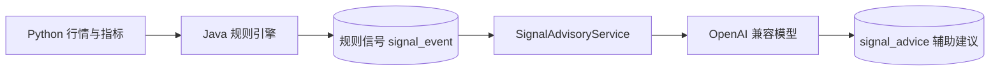

# 架构与开发计划

日报新增独立调度与后台全市场技术扫描，V9保存筛选逐股结果和独立日报投递记录。09:35启动历史技术筛选、15:25刷新报价、15:30按明确交易日历生成并幂等推送；日线人工确认边界保持。模型仅解释已落库的规则合格候选，最多5只，不自动关注。详见 [日报与技术候选](daily-report-screening.md)。

最新行情补充：按用户授权新增腾讯完整一分钟 OHLCV 后备；原东方财富主源失败、无效或过期时启用。Python 统一窗口与单位，Java 规则和写库职责不变。腾讯没有逐分钟成交额，V8 仅对该来源允许分钟成交额为空，不影响原日线。实现与实测见 [腾讯后备](tencent-backup.md)。

## 2026-10-20 用户追加范围

在原有日线与盘中模块之外，新增企微群自然语言订阅。Java 消费智能机器人文本回调，在独立有界线程池调用 DeepSeek 的唯一工具 `add_stock_monitor(stock_query)`；校验原文、股票目录与唯一匹配后，由 Java 调用固定本机 `POST /api/v1/intraday/subscriptions`，在事务内更新关注和盘中监控。重复订阅保留已有阈值与价格，V7 存储消息摘要与执行结果用于去重。Python 职责不变。

“规则信号产生后调用模型”仍约束交易分析；群命令模型仅识别用户新增监控意图，是用户明确追加的独立入口，不生成交易建议，不修改规则信号。真实开关、测试与限制见 [群监控启用记录](group-monitoring.md)。

当前完成TASK-01初始化、TASK-02行情模块、TASK-03指标计算、TASK-04策略引擎、TASK-05通知本地实现，加用户追加的大模型分析模块。完整需求见根目录的原始技术方案，原文件保留。

## 职责

Java（JDK21 / Spring Boot 3.5.16 / MyBatis-Plus）负责数据库迁移、写入、业务调度、规则和模型调用。
Python（3.11+，本机及容器使用 3.12）负责行情标准化、指标计算。Python 不持有数据库凭据。
PostgreSQL 18 持久化，Flyway 管理版本；Docker Compose 编排三服务。

业务时区 Asia/Shanghai；交易日期 DATE，采集时间 TIMESTAMPTZ。量为股，金额为人民币元。
NONE / QFQ / HFQ 分开存储、分开计算。DailyBar 契约要求 is_final；无最终收盘数据不得生成信号。

## 已建立的边界

- Java `/api/v1/health` 为进程探活；`/actuator/health` 包含数据库健康状态。
- Python `/health` 为进程探活，不访问行情服务。
- `app/providers/base.py` 定义行情协议和日线契约。AKShare 已声明依赖；AKShare适配、单位转换和单实例限速已在TASK-02实现；交易日历和收盘确认仍待TASK-06。
- 十张核心表按技术方案生成实体；公共实体目前是数据模型，完整业务 Mapper/Service 在对应任务实现。
- Spring Scheduling 已启用；尚未配置任何定时采集任务，避免在初始化阶段误调用外部数据源。

## 后续顺序

1. TASK-02：AKShare Provider、股票信息、120日以上日线、单位标准化和批量 UPSERT。
2. TASK-03：固定指标版本、MA、MACD 和量能比，独立计算样例验证。
3. TASK-04：自选股、确定性规则、信号与命中明细；提交事务后调用模型分析服务。
4. TASK-05：企业微信通知及幂等、重试；规则信号与模型建议明确标记来源。
5. TASK-06：15:15 交易日扫描、手动任务、任务日志及端到端验收。

无自动下单功能。
## 通知方案追加确认

用户已确认使用企微智能机器人（Bot ID + Secret、长连接），替代原文档的群 Webhook 接入。
TASK-05已完成协议适配、持久通知任务和消息投递；尚未建立真实长连接，详见task05-notifications.md。
凭据仅通过 WECOM_BOT_ID / WECOM_BOT_SECRET 环境变量注入，不保存进文件或日志。

## TASK-02进展

行情适配、内部API、Java批量UPSERT和查询已实现。Java19项测试（含2项原生PostgreSQL集成测试）、Python18项通过。
本机myrag已有核心表已核对并接管Flyway，新增模型建议表；无需Docker。已授权真实联调：目录5575条同步成功，600487日线因上游远端断开未完成。
TASK-02接口及边界见docs/task02-market.md；TASK-03现已完成，后续推进TASK-04。

## TASK-03进展

MA5/10/20/60、DIF/DEA/MACD柱体、前5日均量比及ma-macd-vol-v1版本化计算和UPSERT已完成。
计算由Python执行，Java读取完整已存历史并负责校验及写库。120条预热，明确拒绝不足和混合数据。
Java26项常规测试+4项本机集成测试、Python38项通过。测试样例已回滚，Flyway没有新迁移，未调用真实行情/模型/企微。
独立闭式公式与pandas对照、接口、命令及边界见docs/task03-indicators.md。TASK-04现已完成，详见下节。

## TASK-04进展

自选股管理、SWING_TREND_V1三类确定性规则、不可变参数修订、信号与明细原子落库、并发幂等及提交后模型调用已完成。MA60仅向下穿越触发，卖出观察仅MACD死叉且低于MA20。Java56项、Python38项通过；V3已应用，测试样例清理。当前为手动评估，定时扫描属于TASK-06，通知属于TASK-05。接口与边界见 [TASK-04](task04-strategy.md)。

## TASK-05进展

已实现企微智能机器人WebSocket客户端、三类信号模板、事务内通知任务、并发幂等、ACK判定、有限指数退避及UNKNOWN隔离。默认关闭，未连接真实企微；缺具体群chatid与真实发送授权。Java81项、Python38项通过，V4已应用，临时schema已清理。任务06交易日扫描与每日汇总未实现。边界及运行命令见 [TASK-05](task05-notifications.md)。

## TASK-06进展

已实现交易日历显式导入、源/日期绑定的人工收盘确认、15:15日线扫描、手动执行、任务与逐股明细、数据库互斥和遗留任务恢复标记。用户已确认允许人工确认后的当日入库、指标和策略路径；历史行为保留。默认不执行真实扫描，缺日历或当日未确认即跳过。Java100项、Python39项通过，V5已应用，详见 [TASK-06](task06-daily-scan.md)。此前TASK-02至05段落为各阶段快照，日线现已真实入库864条，企微单条测试已成功ACK；完整真实收盘扫描仍待单独授权和验收。

## 用户追加：盘中短线监控

用户明确扩展一期范围，新增沪深自选股分钟监控，原日线行为保留。Python负责分钟数据和窗口指标，Java负责规则、配置、状态、去重和通知。每分钟第5秒独立调度，缺日历/休市/午休/过期数据跳过；五分钟±2%、20分钟高点和1.5倍量能，以及人工价格阈值；同类冷却15分钟。V6已应用，Java118项/Python49项通过；当前默认关闭，未进行真实分钟行情或群推送。文档见 [盘中监控](intraday-monitoring.md)。
