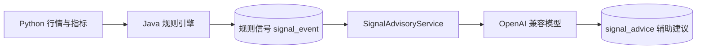

# 架构与开发计划

2026-10-23已授权部署扫描覆盖及定向补跑V23：逐股诊断、持仓/关注优先、失败报价继续轮转、受控补跑和通知去重。另新增筹码集中候选V24，按90%集中度≤10%、70%≤6%、20日均成交额≥1亿元筛选，完成模拟验证，默认关闭、尚未部署；见[覆盖补跑](scan-coverage-and-recovery.md)及[筹码策略](chip-concentration.md)。

2026-10-23群消息类别及策略标识展示已完成并通过回归，11:18获授权重启Java部署并验证，Python保持运行：统一类别/动作、中文策略、适用范围及确认阶段，个人归属提前；不改触发规则、路由、去重及模型调用。见[群消息标识](group-message-identities.md)。

2026-10-23沪深300日线故障修复已获授权部署并验证：东方财富主源、腾讯后备，完整窗口独立计算；按来源隔离当日收盘确认，状态区分数据缺失与大盘偏弱，不改策略阈值或数据库迁移。见[指数后备源](trend-index-backup.md)。

2026-10-22新增独立趋势跟踪模块：MA60/120、20日突破、沪深300MA200过滤、盘中预告与收盘确认、个人成交批次及ATR风控。Java调度/规则/写库，Python计算/行情；已获授权本机启用并迁移至V22，默认配置仍关闭。板块排序按用户确认暂缓。详见[趋势跟踪](trend-following.md)及[部署记录](trend-deployment-20261022.md)。

2026-10-22新增每日股票智能表格候选功能：机器人授权MCP、独立初始化与公开股票日归档、冻结及不明结果停止重发；默认关闭，V21仅隔离测试，不修改运行库。见[文档接入与配置](wecom-stock-document.md)。

2026-10-21完成的OPT-00—03已于2026-10-22授权部署至V20：阶段诊断、来源与通知追溯；持续企微重连；5分钟RSI新浪因子后备、退避与预算；分笔成交审计及基准核对恢复。见[部署记录](deployment-20261022.md)；完整回放、策略研究和预算治理尚未完成。

2026-10-21新增V17个人双周期RSI做T观察：Python计算同序列完整5/15分钟Wilder RSI14；Java基于当日申报持仓/可卖生成主动减仓、买入/回补观察，14:50检查手工成交净差额提醒恢复底仓，不下单、不逐次调用模型，见[做T观察](t-rsi-observation.md)。

2026-10-21新增V16个人仓位：群+用户+股票手工申报数量、成本、可卖，公共规则产生后追加本群个人仓位约束提示，不额外逐人调用模型；跨日可卖未知，不自动下单，见[个人仓位](personal-positions.md)。

2026-10-21按用户确认将缩量回踩候选推送调整为交易日09:40、15:30各一次；数据准备、盘中转强与日报保持，见[早晚推送](pullback-twice-daily.md)。

2026-10-21新增群助手全局取消关注：用户明确单股命令后移除全群公共关注并停用公共监控，个人价位、历史数据及全市场选股保持；增加旧日线任务提交复核，见[删除关注](remove-watch.md)。

2026-10-21新增选股结果只读解释API和群工具：日线规则用保存快照，未入池回踩股按校验后的本地历史与原规则复算，区分不满足、未评估、数据不足及前5名排序；不改变筛选或写库，见[选股解释](selection-explanations.md)。

2026-10-21新增多群白名单和通知按群投递，关注名单继续共享，个人价位和对话按群+用户隔离；复用一条机器人连接，见[多群支持](multi-chat.md)。

2026-10-21已启用分钟收盘向下穿越前日MA60预警，V15保存基准和冷却状态；缺失或除权基准异常时跳过，见[MA60预警](intraday-ma60-risk.md)。

2026-10-21定位并修复分钟行情整窗误拒绝：两来源实际返回末尾下一分钟未完成行，仅剔除此行及当前分钟，保留此前完整窗口，不平移时间；新增细分校验原因与行/字段诊断。见[分钟校验修复](minute-validation-fix.md)。

2026-10-21补齐盘中扫描主动异常提醒：V14独立状态与队列，连续3轮同类故障报警、15分钟冷却、完整成功后恢复一次；正常跳过不报警，UNKNOWN不盲重发。详见[扫描故障提醒](scan-fault-alerts.md)。

2026-10-21盘中可靠性修复：腾讯短暂连接/服务端错误最多追加一次有预算重试，主源采集时间改为完成时刻；Python主备诊断与Java分阶段安全错误码落库，保留所有策略和投递边界。见[失败定位与验证](intraday-reliability-20261021.md)。

已追加用户级个人止盈止损价位：V13独立配置和投递队列，群助手绑定回调userid，同股分钟数据复用，不改公共价位；仍发本群并标明所属用户。同时本机日线任务及15:15调度启用，保留人工收盘确认。见[个人提醒与日线启用](personal-price-alerts.md)。

群助手新增V12关注人/自设昵称关系和受控多轮工具对话，按群+用户隔离短时内存上下文。查询名单、策略、状态及已落库信号；明确新增关注与关注人同事务。历史归属未知不回填，交易信号规则不变。见[群对话助手](group-assistant.md)。

缩量回踩另增V11独立10分钟候选汇总队列：开市日09:40～11:30、13:10～15:00按10分钟槽推送全市场筛选的前5只待确认候选，午休休市不发。日线历史复用，未完成覆盖明确标注；分钟转强即时提醒和15:30日报保持。

2026-10-21新增独立两阶段强势股缩量回踩：后台日线入池、有限候选分钟放量转强确认，V10持久化快照与触发游标。同步修复日线后备、日报依据和通知中文名/信号模型开关。具体口径、API及限制见[策略说明](strong-pullback.md)。

日报新增独立调度与后台全市场技术扫描，V9保存筛选逐股结果和独立日报投递记录。09:35启动历史技术筛选、15:25刷新报价、15:30按明确交易日历生成并幂等推送；日线人工确认边界保持。模型仅解释已落库的规则合格候选，最多5只，不自动关注。详见 [日报与技术候选](daily-report-screening.md)。

最新行情补充：按用户授权新增腾讯完整一分钟 OHLCV 后备；原东方财富主源失败、无效或过期时启用。Python 统一窗口与单位，Java 规则和写库职责不变。腾讯没有逐分钟成交额，V8 仅对该来源允许分钟成交额为空，不影响原日线。实现与实测见 [腾讯后备](tencent-backup.md)。

## 2026-10-20 用户追加范围

在原有日线与盘中模块之外，新增企微群自然语言订阅。Java 消费智能机器人文本回调，在独立有界线程池调用 DeepSeek 的唯一工具 `add_stock_monitor(stock_query)`；校验原文、股票目录与唯一匹配后，由 Java 调用固定本机 `POST /api/v1/intraday/subscriptions`，在事务内更新关注和盘中监控。重复订阅保留已有阈值与价格，V7 存储消息摘要与执行结果用于去重。Python 职责不变。

“规则信号产生后调用模型”仍约束交易分析；群命令模型仅识别用户新增监控意图，是用户明确追加的独立入口，不生成交易建议，不修改规则信号。真实开关、测试与限制见 [群监控启用记录](group-monitoring.md)。

当前完成TASK-01初始化、TASK-02行情模块、TASK-03指标计算、TASK-04策略引擎、TASK-05通知本地实现，加用户追加的大模型分析模块。完整需求见根目录的原始技术方案，原文件保留。

## 职责

Java（JDK21 / Spring Boot 3.5.16 / MyBatis-Plus）负责数据库迁移、写入、业务调度、规则和模型调用。
Python（3.11+，本机及容器使用 3.12）负责行情标准化、指标计算。Python 不持有数据库凭据。
PostgreSQL 18 持久化，Flyway 管理版本；Docker Compose 编排三服务。

业务时区 Asia/Shanghai；交易日期 DATE，采集时间 TIMESTAMPTZ。量为股，金额为人民币元。
NONE / QFQ / HFQ 分开存储、分开计算。DailyBar 契约要求 is_final；无最终收盘数据不得生成信号。

## 已建立的边界

- Java `/api/v1/health` 为进程探活；`/actuator/health` 包含数据库健康状态。
- Python `/health` 为进程探活，不访问行情服务。
- `app/providers/base.py` 定义行情协议和日线契约。AKShare 已声明依赖；AKShare适配、单位转换和单实例限速已在TASK-02实现；交易日历和收盘确认仍待TASK-06。
- 十张核心表按技术方案生成实体；公共实体目前是数据模型，完整业务 Mapper/Service 在对应任务实现。
- Spring Scheduling 已启用；尚未配置任何定时采集任务，避免在初始化阶段误调用外部数据源。

## 后续顺序

1. TASK-02：AKShare Provider、股票信息、120日以上日线、单位标准化和批量 UPSERT。
2. TASK-03：固定指标版本、MA、MACD 和量能比，独立计算样例验证。
3. TASK-04：自选股、确定性规则、信号与命中明细；提交事务后调用模型分析服务。
4. TASK-05：企业微信通知及幂等、重试；规则信号与模型建议明确标记来源。
5. TASK-06：15:15 交易日扫描、手动任务、任务日志及端到端验收。

无自动下单功能。
## 通知方案追加确认

用户已确认使用企微智能机器人（Bot ID + Secret、长连接），替代原文档的群 Webhook 接入。
TASK-05已完成协议适配、持久通知任务和消息投递；尚未建立真实长连接，详见task05-notifications.md。
凭据仅通过 WECOM_BOT_ID / WECOM_BOT_SECRET 环境变量注入，不保存进文件或日志。

## TASK-02进展

行情适配、内部API、Java批量UPSERT和查询已实现。Java19项测试（含2项原生PostgreSQL集成测试）、Python18项通过。
本机myrag已有核心表已核对并接管Flyway，新增模型建议表；无需Docker。已授权真实联调：目录5575条同步成功，600487日线因上游远端断开未完成。
TASK-02接口及边界见docs/task02-market.md；TASK-03现已完成，后续推进TASK-04。

## TASK-03进展

MA5/10/20/60、DIF/DEA/MACD柱体、前5日均量比及ma-macd-vol-v1版本化计算和UPSERT已完成。
计算由Python执行，Java读取完整已存历史并负责校验及写库。120条预热，明确拒绝不足和混合数据。
Java26项常规测试+4项本机集成测试、Python38项通过。测试样例已回滚，Flyway没有新迁移，未调用真实行情/模型/企微。
独立闭式公式与pandas对照、接口、命令及边界见docs/task03-indicators.md。TASK-04现已完成，详见下节。

## TASK-04进展

自选股管理、SWING_TREND_V1三类确定性规则、不可变参数修订、信号与明细原子落库、并发幂等及提交后模型调用已完成。MA60仅向下穿越触发，卖出观察仅MACD死叉且低于MA20。Java56项、Python38项通过；V3已应用，测试样例清理。当前为手动评估，定时扫描属于TASK-06，通知属于TASK-05。接口与边界见 [TASK-04](task04-strategy.md)。

## TASK-05进展

已实现企微智能机器人WebSocket客户端、三类信号模板、事务内通知任务、并发幂等、ACK判定、有限指数退避及UNKNOWN隔离。默认关闭，未连接真实企微；缺具体群chatid与真实发送授权。Java81项、Python38项通过，V4已应用，临时schema已清理。任务06交易日扫描与每日汇总未实现。边界及运行命令见 [TASK-05](task05-notifications.md)。

## TASK-06进展

已实现交易日历显式导入、源/日期绑定的人工收盘确认、15:15日线扫描、手动执行、任务与逐股明细、数据库互斥和遗留任务恢复标记。用户已确认允许人工确认后的当日入库、指标和策略路径；历史行为保留。默认不执行真实扫描，缺日历或当日未确认即跳过。Java100项、Python39项通过，V5已应用，详见 [TASK-06](task06-daily-scan.md)。此前TASK-02至05段落为各阶段快照，日线现已真实入库864条，企微单条测试已成功ACK；完整真实收盘扫描仍待单独授权和验收。

## 用户追加：盘中短线监控

用户明确扩展一期范围，新增沪深自选股分钟监控，原日线行为保留。Python负责分钟数据和窗口指标，Java负责规则、配置、状态、去重和通知。每分钟第5秒独立调度，缺日历/休市/午休/过期数据跳过；五分钟±2%、20分钟高点和1.5倍量能，以及人工价格阈值；同类冷却15分钟。V6已应用，Java118项/Python49项通过；当前默认关闭，未进行真实分钟行情或群推送。文档见 [盘中监控](intraday-monitoring.md)。
